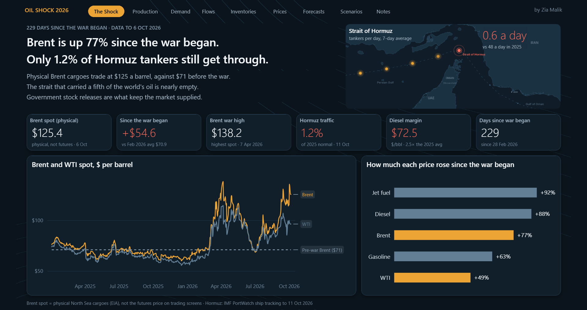
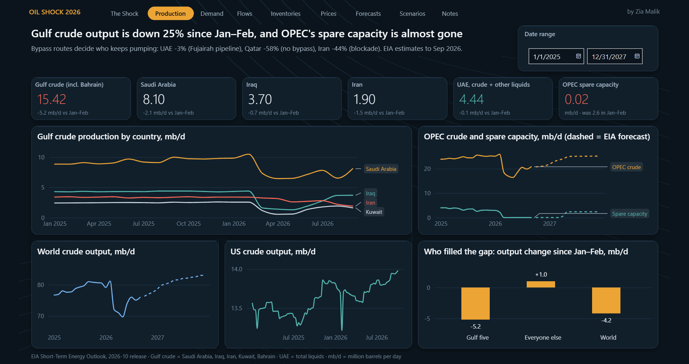
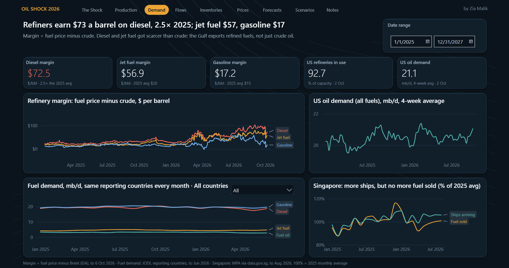
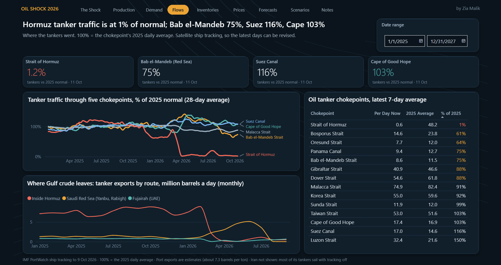
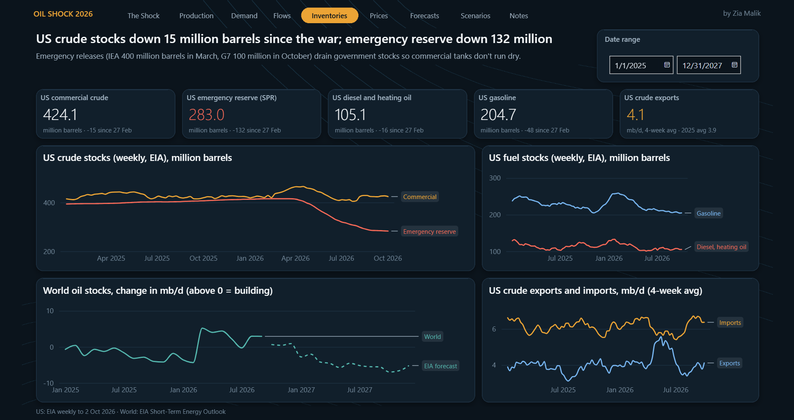
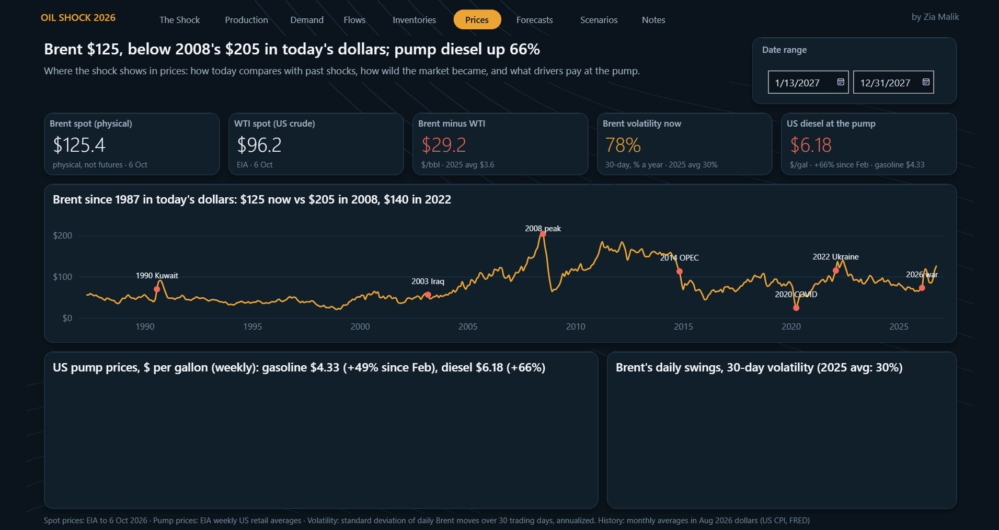
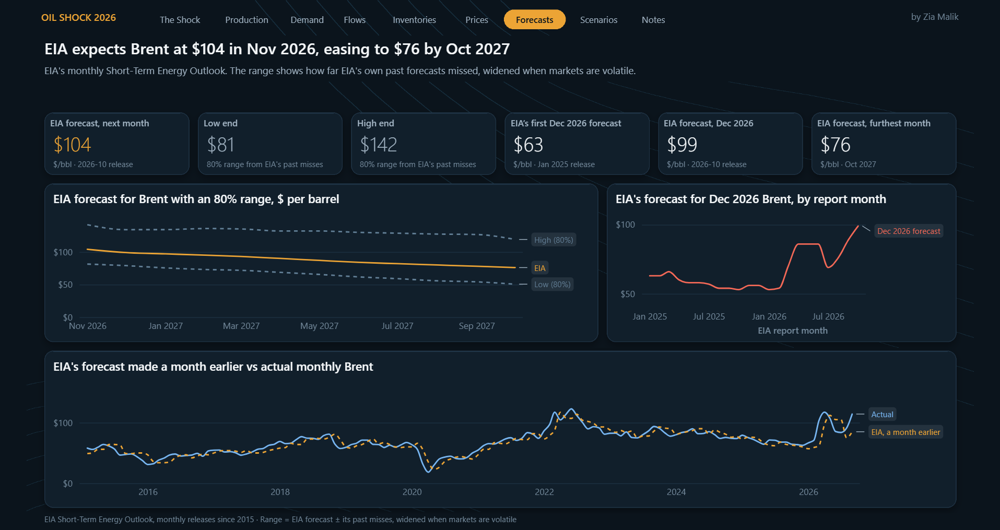
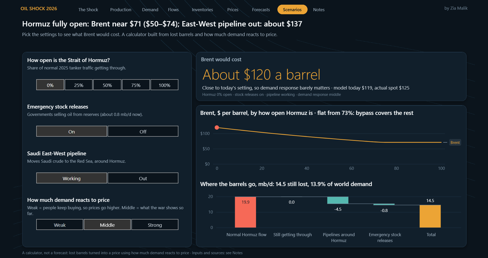
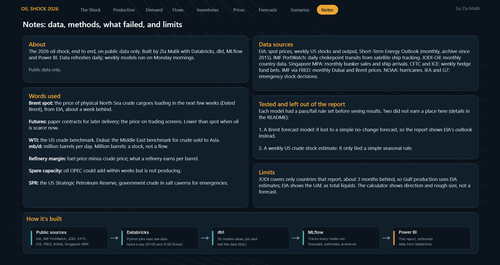

# The 2026 Oil Supply Shock


**What happened to the world oil market when the Strait of Hormuz closed, and what does it cost?**

On February 28, 2026, the US–Iran war began. Tanker traffic through Hormuz, which carried about a fifth of the world's oil, fell from around 48 tankers a day in 2025 to a handful. I wanted to see the whole chain on public data only: where supply disappeared, who replaced it, how ships rerouted, how stocks and prices reacted, and what forecasters expect next.

**[▶ Open the live report](https://app.powerbi.com/view?r=eyJrIjoiYTRiMzkxZTAtZTc2ZS00N2M1LWE1ODQtYzBmNDJmNzgwNWI5IiwidCI6ImEyYjYxNTdiLWZlM2ItNGRlZi05OTAzLTc4YTRlMmU5NTNhYiJ9)** · refreshed twice a day



---

## What I found

Numbers are from the October 13–14, 2026 refresh and move daily.

| | |
|---|---|
| **Brent spot** | about **$125** a barrel, up **77%** on the February average ($70.9). War high $138 on April 7 |
| **Hormuz tanker traffic** | about **2%** of the 2025 daily average |
| **Gulf crude output** | down about **25%** (15.4 mb/d in September). Gulf five −5.2 mb/d since Jan–Feb, rest of the world +1.0, world −4.2 |
| **Refined fuels** | rose more than crude: jet **+92%**, diesel **+88%**, gasoline **+63%**, WTI **+49%** |
| **US pump prices** | gasoline **$4.35** (+50%), diesel **$6.20** (+67%) |
| **Volatility** | Brent's 30-day volatility about **78%** a year vs 30% in 2025 (April peak about 110%) |
| **History** | high, but not a record: 2008 peaked at about **$205** in today's dollars, 2022 at about **$140** |
| **Rerouting** | Saudi exports moved to the Red Sea (Yanbu peaked at about 4.5× its 2025 level in June) until that route also collapsed in August. Cape of Good Hope traffic is 111% of 2025 |
| **Stocks** | the US emergency reserve (SPR) is down about 132 million barrels; commercial crude only about 15 million |
| **Outlook** | EIA expects about **$104** in November 2026 (80% range about $81–142), easing to about $76 by October 2027 |

Two results I didn't expect, and kept anyway:

- **My Brent forecast lost.** I built a gradient-boosting model and set a pass/fail rule before looking at results: it had to beat a no-change forecast (next month = this month's price) on 1- and 2-month forecasts, 2015–2026. It didn't, and EIA's forecast also did better than mine. So the report shows EIA's outlook, not mine. Oil prices react fast to news, so today's price already holds most of what is known, which makes simple forecasts hard to beat.
- **My weekly US crude stock estimate only tied a seasonal rule** overall (about 14% better in war weeks). It is not in the report; it is tested live below.

---

## How it's built


- **Databricks Free Edition:** one scheduled job runs at 07:00 and 21:00 Dubai time: `ingest → dbt_build → ml_scenarios → ml_inventory_nowcast → ml_eia_range_refresh`. Every source is pulled by code; there is no manual data entry.
- **dbt Core** (run inside Databricks): staging views in `silver`, marts as tables in `gold`, reference seeds, and tests for duplicates, missing keys and value ranges.
- **MLflow:** every model run is logged (inputs, settings, accuracy) so results can be reproduced and compared.
- **Power BI:** imports the gold tables, refreshes after each run, published to the web.

Secrets (API keys, Databricks token) live in a Databricks secret scope, never in the repo.

---

## The report (9 pages)

Each page answers one question. A chart stayed only if it helped answer it.

| Page | Question | How the numbers are made |
|---|---|---|
| **1 The Shock** | How big is it? | EIA daily Dated Brent spot vs its 1–27 Feb average; Hormuz tankers per day (PortWatch, 7-day avg) vs 2025 |
| **2 Production** | Where did supply disappear, and who filled the gap? | EIA Short-Term Energy Outlook, latest release: last estimated month minus the Jan–Feb average |
| **3 Demand** | How did fuel demand and refiners respond? | Margins = fuel spot minus Brent (EIA). Fuel demand from JODI on a fixed set of countries that reported every month since Jan 2025, so the line is like-for-like. Singapore bunker sales and arrivals (MPA) |
| **4 Flows** | How did ships reroute? | PortWatch daily transits for five routes on one shared scale, each vs its own 2025 average; Gulf crude exports by port (tonnes × 7.33 bbl/t) |
| **5 Inventories** | Did stocks cushion it? | EIA weekly stocks, SPR, US crude exports and imports (4-week averages) |
| **6 Prices** | How does today compare with past shocks? | Brent since 1987 in today's dollars (monthly avg × latest US CPI ÷ that month's CPI); 30-day volatility (std. dev. of daily log returns × √252, computed in dbt); EIA weekly pump prices |
| **7 Forecasts** | What does EIA expect, and how accurate has it been? | 141 monthly STEO files since 2015; 80% range = EIA forecast ± its own past misses, widened when markets are volatile |
| **8 Scenarios** | What if Hormuz reopens 25%, 50%, 100%? | Barrels still lost = Hormuz flow lost − bypass pipelines (4.5 mb/d) − stock releases (0.8 mb/d). Price = today's Brent × e^((lost − today's lost) ÷ (world demand × elasticity)). Middle elasticity 0.26 (implied by the war so far); low/high from Caldara et al. (2019) and Kilian (2019). A calculator, not a forecast |
| **9 Notes** | Sources, glossary, limits, what was tested and left out | |

<details>
<summary>Screenshots</summary>










</details>

---

## Why Brent is $125 here and about $105 on Google

Google and most news sites show **futures**: paper contracts for later delivery. This report shows **Dated Brent spot**: physical North Sea cargoes loading in the next few weeks. When oil you can load now is scarce, it sells at a premium (about $19 now, about $35 at the April peak). Both numbers are right; they measure different things. EIA stopped publishing NYMEX futures in April 2024 and Brent futures data is paid, so there is no futures curve in the report.

---

## What I built and cut

1. **My Brent forecast model.** Lost to a no-change forecast under a rule I set before looking. Kept here, not in the report.
2. **Weekly US stock estimate.** Tied a seasonal rule. Kept here with a live test.
3. **A Gulf news index and events list (GDELT).** The index compared each day with the war's own recent baseline, so a day with six ships hit could score "normal". The events list needed daily manual upkeep, which breaks the no-manual-entry rule. Cut.
4. **Hedge-fund positioning, Dubai vs Brent, and the Brent–WTI spread charts.** Built because the data existed, not because a page needed them. Replaced with volatility, pump prices and Brent since 1987 in today's dollars. Lesson: start from the question, not the dataset.
5. **Eurostat bunker volumes.** The Netherlands showed +7% in Q1 2026 in Eurostat against −25% in the Port of Rotterdam's own figures. I couldn't tell which was right, so neither is in the report.
6. **Bunker prices.** Proprietary (Platts, Argus, Ship & Bunker). A diesel proxy would be visibly wrong to anyone who trades bunkers, so I show volumes instead.
7. **OPEC's monthly report.** Blocks automated downloads (HTTP 403), so it was dropped under the no-manual-entry rule.

---

## Live test: weekly US crude stock change

Each Thursday I compare the models' estimate with EIA's reported change in US commercial crude stocks (million barrels).

| Week ending | Ridge | Gradient boosting | Seasonal rule | EIA actual |
|---|---|---|---|---|
| Oct 9, 2026 | +1.5 | +1.0 | +2.9 | *due Oct 15* |

---

## Repo layout

```
src/                       Python loaders, one per source (<source>_loader.py), shared HTTP helper
notebooks/00_setup/        write helpers (API call log, load watermarks)
notebooks/01_ingestion/    first loads and backfills: 11 EIA, 12 JODI, 13 PortWatch, 13b Gulf ports,
                           13c Singapore, 14 CFTC/ICE, 15 FRED, 19 EIA forecast archive
notebooks/02_jobs/         20_ingest_run, 21_create_job (the scheduled job), 22_dbt_build
notebooks/04_ml/           42 forecast test, 43 stock nowcast, 44 scenarios, 46 EIA forecast range
dbt/models/staging/        one view per source (silver)
dbt/models/marts/          facts and dimensions (gold)
dbt/seeds/                 reference lists: chokepoints, countries, Gulf ports, price series, history events
dbt/tests/                 custom tests (prices positive, EIA Brent matches IMF)
images/                    report screenshots
```

Notebook 42 is not in the scheduled job: it ran once to test the forecast. Some dbt models and loaders from features I cut (news index, storms, macro inputs) still run in the job because an old feature table depends on them; I'm removing them in a cleanup pass.

---

## Sources

| Source | Used for |
|---|---|
| US Energy Information Administration (EIA) | Spot prices, pump prices, weekly stocks and flows, Short-Term Energy Outlook and its archive |
| JODI Oil World Database | Fuel demand by country |
| IMF PortWatch | Chokepoint transits and port exports. *Sources: UN Global Platform; IMF PortWatch* |
| FRED, Federal Reserve Bank of St. Louis | US consumer price index (CPIAUCSL) for today's-dollar prices |
| Maritime and Port Authority of Singapore | Bunker sales and vessel arrivals. *MPA via data.gov.sg* |
| CFTC Commitments of Traders | Positioning (tested, not shown) |

**Not available free:** oil futures after April 2024, tanker freight rates, war-risk insurance, daily Gulf benchmarks, bunker prices, Singapore/ARA/Fujairah weekly stocks.

---

## Limits

- Prices are labeled spot with their date. EIA publishes about a week late.
- Charts show association, never proof that an event caused a price move.
- Port volumes are estimates from ship tracking; Iran is excluded because many Iranian tankers switch off their transponders.
- The scenario page is a calculator: it leaves out risk premiums and reserve refilling.
- Built on Databricks Free Edition, which is for non-commercial use. The project uses public data only.

---

Built with AI-assisted development (Claude) for code, documentation and review. Every number was checked against its source.

**Zia Malik** · Senior Data Analyst
